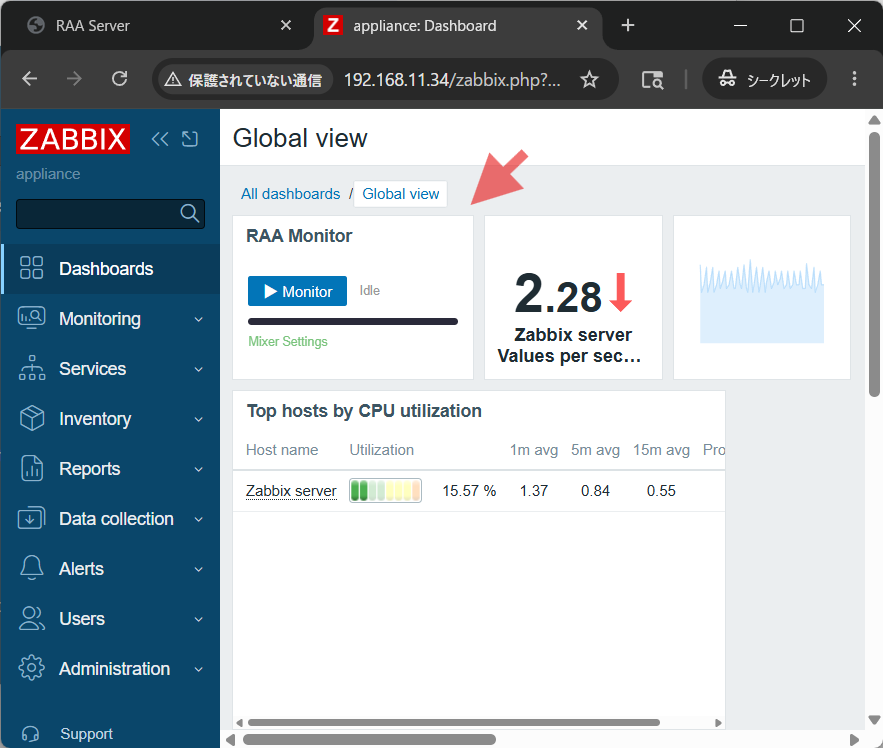

# Remote Audio Aggregation (RAA)

[English version here](README.md)

複数の Windows PC のシステム音声をキャプチャし、ミキシングした音声をブラウザにストリーミングする低遅延音声集約システムです。クライアント/サーバともに低負荷、NAT耐性あり、HTTPS環境不要。

<table>
  <tr>
    <td align="center"><b>Win32 クライアント</b><br></td>
    <td align="center"><b>サーバー WebUI</b><br></td>
    <td align="center"><b>Zabbixモジュール</b><br></td>
  </tr>
</table>

## アーキテクチャ

```
[Windows PC-A] ──UDP:4010──┐
[Windows PC-B] ──UDP:4010──┤──→ [Linux サーバー] ──WebSocket:4011── [Zabbix]
[Windows PC-C] ──UDP:4010──┘           │
                                    WebUI :4011
```

- **クライアント → サーバー**: RTP（Opus）でPC音声を送信。 宛先ポートはudp:4010。
- **ブラウザ → サーバー**: http + WebSocket。 宛先ポートはTCP:4011。
- **Zabbix → サーバー**: WebSocket。 宛先ポートはTCP:4011。
- **音声フォーマット**: Opus 48 kHz モノラル、20 ms フレーム、64 kbps、DTX 有効

## コンポーネント

| コンポーネント | 概要 |
|---|---|
| [Win32 クライアント](client/)  | システムトレイアプリ、WASAPI プロセスループバックキャプチャ、RTP/UDP 送信 |
| [Node.js サーバー](server/)  | UDP 受信、ミキサー Worker Thread、WebSocket による再生、REST 管理 API |
| [Zabbix モジュール](module/)  | WebSocket 音声プレーヤーとミキサー設定リンクを持つ Zabbix ダッシュボードウィジェット |

## ダウンロード

ビルド済最新バージョンは [GitHub Releases](https://github.com/daig0rian/remote-audio-aggregation/releases) へ公開されます。

| ファイル | 内容 |
|----------|------|
| `raa-client.exe` | Win32 クライアント — インストーラー不要、そのまま実行 |
| `raa-server-x.y.z.tgz` | サーバー Node.js パッケージ |
| `install.sh` | サーバーインストールスクリプト |
| `raa_monitor-x.y.z.zip` | Zabbix ダッシュボードウィジェットモジュール |

## 動作の仕組み

### 音声パイプライン（20 ms サイクル）

1. **Win32 クライアント**が WASAPI Process Loopback でシステム音声をキャプチャし、Opus でエンコードして RTP パケットを UDP で送信。
2. **サーバーの UDP 受信部**が RTP ヘッダーを解析し、SSRC・RTP タイムスタンプ・マーカービットを取得。ギャップ検出（マーカービット、または 300ms 超の無音）を行い、生 Opus データをミキサー Worker Thread に転送する。
3. **ミキサー Worker Thread** が受信した Opus フレームをデコードして PCM に変換し、クライアントごとの RTP タイムスタンプ索引ジッターバッファにエンキュー。精密な 20 ms タイマーで各クライアントのバッファからフレームを取り出し（欠損時は PLC）、クライアントごとの音量スケーリングを適用して PCM を混合し、Opus に再エンコードしてメインスレッドに送信。
4. **メインスレッド**がエンコード済みフレームをすべての接続 WebSocket リスナーに送信。
5. **ブラウザ**が WebAssembly で Opus をデコードし、Web Audio API でスケジュール再生。

## パフォーマンス

### 検証済みの性能特性

**テスト環境**: 1 vCPU（Intel i5-6500T 2.50 GHz）、2 GB RAM、Ubuntu 24.04 LTS（KVM VM）

**シナリオ: 40 接続クライアント、10 クライアント同時発話、150 秒計測**

| 指標 | 値 |
|------|----|
| ミキサーサイクル時間 — 平均 | 0.87 ms |
| ミキサーサイクル時間 — p99 | ~2.0 ms |
| ミキサーサイクル時間 — 最大 | ~4.4 ms |
| サーバー CPU 使用率 | ~20 % |

ミキサーの処理予算は 1 サイクル 20 ms。同時発話 10 クライアントで 1 vCPU でも予算の 5 % 以下しか消費しない。

### 想定される性能限界

| 同時発話クライアント数 | ミキサー予算消費 | 備考 |
|----------------------|----------------|------|
| 10 | ~5 % | ✅ 1 vCPU / 2 GB で検証済み |
| 25 | ~12 % | 十分な余裕あり |
| 40 | ~70 % | デコード ~12 ms、限界に近づく |
| 50 以上 | > 100 % | フレーム落ちが発生する見込み |

WebSocket 聴取クライアント数の影響は軽微で、~200 同時ブラウザまでほぼ問題なし（WS 送信 1 回あたりの追加コストはフレームヘッダー ~10 バイトのみ、~150 バイトの Opus ペイロードは全クライアントで共有）。

### パフォーマンス監視

サーバーは 5 秒ごとに `info` レベルでタイミング統計をログ出力します。

```json
{"msg":"mix cycle stats","mean_ms":"0.87","p99_ms":"2.0","max_ms":"4.42","avg_active":"11.0"}
{"msg":"event loop delay","mean_ms":"10.6","p99_ms":"12.5","max_ms":"16.8"}
```

`avg_active` は 1 サイクルで実際にミックスされたクライアントの平均数。`event loop delay` はメインスレッドの応答性（UDP 受信・WebSocket 送信・HTTP）を反映します（同一 VM での負荷テスト実行により高めに計測）。

負荷テストの再現手順:

```bash
# 40 クライアント登録、10 クライアントが音声送信、ローカルホスト宛
node bench/load-test.js 40 10 127.0.0.1
```

## 技術スタック

### サーバー
- **ランタイム**: Node.js ≥ 24（LTS）
- **HTTP/REST**: [Fastify](https://fastify.dev/)
- **WebSocket**: [ws](https://github.com/websockets/ws)
- **Opus コーデック**: [@evan/opus](https://github.com/evan/opus)（N-API ネイティブバインディング）
- **ロギング**: [pino](https://getpino.io/)（構造化 JSON、`LOG_LEVEL` 環境変数で制御）
- **スレッド**: Worker Threads（ミキサーが HTTP/WS イベントループとは独立して動作）

### Win32 クライアント
- **言語**: C++ / Win32 API（MSVC）
- **音声キャプチャ**: WASAPI `AUDCLNT_STREAMFLAGS_PROCESS_LOOPBACK`（マスターボリュームと独立してプロセスの音声をキャプチャ）
- **コーデック**: libopus 1.3.1（静的リンク、外部 DLL 不要）
- **ネットワーク**: Winsock2 UDP、標準 RTP フレーミング（RFC 3550 + RFC 7587）
- **UI**: `Shell_NotifyIcon` システムトレイ（アクティブ / 無音 / エラーの 3 状態アイコン）
- **設定**: `%APPDATA%\raa-client\raa-client.ini`

## ディレクトリ構成

```
remote-audio-aggregation/
├── client/                  # Win32 C++ クライアント
│   ├── src/
│   │   └── raa-client.cpp   # メインソース（WASAPI + libopus + RTP + トレイ UI）
│   ├── deps/                # libopus スタティックライブラリとヘッダー
│   ├── icons/               # active.ico / silent.ico / error.ico
│   ├── build.bat            # MSVC ビルドスクリプト
│   ├── get_opus.bat         # libopus のソースからのビルド
│   ├── app.manifest         # Windows 10 以降互換マニフェスト
│   └── raa-client.rc        # リソースファイル（アイコン、バージョン情報）
├── module/                  # Zabbix ダッシュボードウィジェット
│   ├── manifest.json
│   ├── Widget.php
│   ├── actions/WidgetView.php
│   ├── includes/WidgetForm.php
│   ├── views/
│   │   ├── widget.edit.php
│   │   └── widget.view.php
│   └── assets/
│       ├── css/widget.css
│       └── js/
│           ├── class.widget.js
│           ├── raa-player.js
│           └── opus-decoder.bundle.js
└── server/                  # Node.js サーバー
    ├── src/
    │   ├── main.js          # エントリーポイント: UDP・HTTP・WS の接続
    │   ├── udp.js           # RTP パケット受信・解析
    │   ├── clients.js       # クライアントレジストリ、Opus デコード、設定永続化
    │   ├── mixer.js         # Worker Thread: ジッターバッファ・PLC・混合・エンコード
    │   ├── ogg-reader.js    # Ogg ページパーサー（BGM クライアント用）
    │   └── logger.js        # 各モジュール共有の pino インスタンス
    ├── assets/
    │   └── goldberg-var1.opus  # 内蔵テスト音源（パブリックドメイン、~1 MB）
    ├── public/
    │   └── index.html       # 管理 WebUI + ブラウザ音声プレイヤー
    ├── package.json
    ├── deploy.bat           # SCP デプロイ + リモート再起動ヘルパー
    └── raa-server.service   # systemd ユニットファイル
```

## サーバーセットアップ（Ubuntu 24.04 LTS）

### 1. nvm で Node.js をインストール

```bash
curl -o- https://raw.githubusercontent.com/nvm-sh/nvm/v0.39.0/install.sh | bash
source ~/.bashrc
nvm install 24
nvm alias default 24
```

### 2. raa-server をインストール

```bash
curl -fsSL https://github.com/daig0rian/remote-audio-aggregation/releases/latest/download/install.sh | bash
```

スクリプトが行う処理:
- Node.js ≥ 24 を確認（未インストールの場合はエラーで終了）
- `build-essential` と `libopus-dev` が未インストールなら apt で導入（sudo、初回のみ）
- サーバーパッケージを `~/raa-server` に展開
- 現在のユーザーとして `npm install` を実行（`@evan/opus` ネイティブアドオンをコンパイル）
- **systemd ユーザーサービス**を登録・起動
- ログインなしでブート時から起動できるよう `loginctl enable-linger` を実行（sudo、初回のみ）

### サービス管理

```bash
systemctl --user status raa-server
systemctl --user restart raa-server
systemctl --user stop raa-server
journalctl --user -u raa-server -f
journalctl --user -u raa-server --since "1 hour ago"
```

### フォアグラウンド起動（開発・デバッグ用）

```bash
cd ~/raa-server
node src/main.js
# デバッグログを有効にする場合:
LOG_LEVEL=debug node src/main.js
```

デフォルトポート: UDP `4010`（音声入力）、HTTP/WS `4011`（Web インターフェース）。  
環境変数で変更可能: `UDP_PORT=5004 HTTP_PORT=8080 node src/main.js`

## Win32 クライアント

### ダウンロード（推奨）

[GitHub Releases](https://github.com/daig0rian/remote-audio-aggregation/releases) から `raa-client.exe` をダウンロードして好みのフォルダに保存し、そのまま実行してください。

### ソースからビルド

Visual Studio Build Tools 2022 以降（"C++ によるデスクトップ開発" ワークロードと Windows SDK）が必要です。

```bat
cd client
build.bat
```

`deps\libopus.lib` が存在しない場合、`build.bat` が自動的に libopus をソースからビルドします。出力は `client\raa-client.exe` です。

### 初回起動

設定ファイルがない状態で初回起動すると、設定ダイアログが自動的に表示されます。サーバーの IP アドレスを入力して OK を押すと、即座に音声キャプチャと送信が始まります。

SSRC（管理 WebUI に表示されるクライアント識別子）は初回起動時に生成され、`%APPDATA%\raa-client\raa-client.ini` に保存されます。

## Zabbix モジュール

`raa_monitor` Zabbix ウィジェットを使うと、Zabbix ダッシュボードから直接 RAA の音声ストリームを監視・試聴できます。

### インストール

1. [GitHub Releases](https://github.com/daig0rian/remote-audio-aggregation/releases) から `raa_monitor-x.y.z.zip` をダウンロードし、Zabbix のモジュールディレクトリに展開します:

   ```bash
   unzip raa_monitor-x.y.z.zip -d /usr/share/zabbix/modules/
   ```

2. Zabbix で **管理 → 一般 → モジュール → ディレクトリをスキャン** を実行し、*RAA Monitor* を **有効化** します。

3. ダッシュボードに **RAA Monitor** ウィジェットを追加し、以下を設定します:

   | 項目 | デフォルト | 説明 |
   |------|-----------|------|
   | RAA Server Host | `10.0.0.1` | RAA サーバーの IP またはホスト名（ブラウザから見えるアドレス） |
   | WebSocket Port | `4011` | RAA サーバーの HTTP/WS ポート |
   | Buffer (ms) | `200` | ジッターバッファサイズ |


## 管理 WebUI

ブラウザで `http://<server>:4011/` を開きます。

- アクティブ・既知のすべてのクライアントをフレンドリーネーム・SSRC・状態付きで一覧表示
- クライアントごとの音量スライダー（0〜200%）・ミュートトグル・名前編集
- 混合ストリームの音声プレイヤー（再生ボタンをクリック）
- 右上の EN/JA ボタンで表示言語を切り替え可能（ブラウザ言語を自動検出）

## 内蔵テストストリーム

サーバーには仮想 BGM クライアント（`bgmtest0`）が組み込まれており、起動直後からパブリックドメインの楽曲をループ再生します。WebUI には **"Test BGM (Goldberg Var.1)"** として表示されます。Win32 クライアントを接続しなくても、ブラウザ → WebSocket → デコーダ → 再生までのエンドツーエンドの疎通確認がすぐに行えます。

音源: バッハ《ゴルトベルク変奏曲 BWV 988 – 第1変奏》、演奏: Shelley Katz  
出典: [musopen.org](https://musopen.org/) · ライセンス: [パブリックドメイン](https://creativecommons.org/publicdomain/mark/1.0/)

## RTP パケットフォーマット

Opus ペイロードタイプ 111（RFC 7587）を使用した標準 RTP（RFC 3550）。Wireshark・VLC・FFmpeg で診断可能。

```
バイト 0:    0x80  (V=2, P=0, X=0, CC=0)
バイト 1:    M | 111  (Marker ビット + PT=111)
バイト 2-3:  シーケンス番号（big-endian）
バイト 4-7:  タイムスタンプ（48 kHz クロック、big-endian）
バイト 8-11: SSRC（big-endian、クライアント識別子）
バイト 12+:  Opus ペイロード（20 ms、48 kHz、モノラル）
```


## ログレベル

| レベル | ログ内容 |
|---|---|
| `info`（デフォルト） | サーバー起動/停止、クライアント接続/切断 |
| `debug` | デコーダリセット、フレーム単位イベント |
| `warn` | ジッターバッファ枯渇、リシンクイベント |

`LOG_LEVEL=debug` 環境変数、または systemd ユニットファイルで設定。
