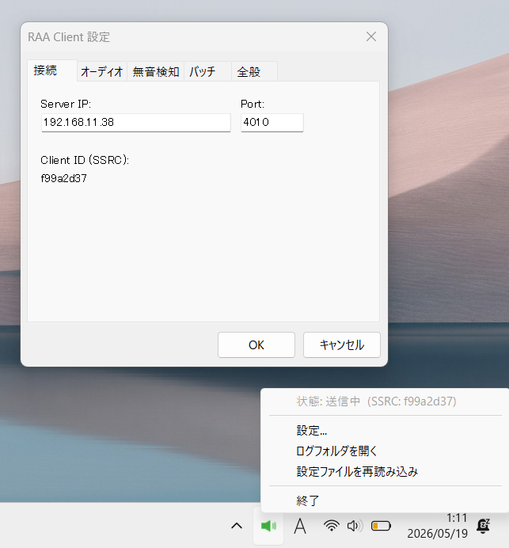
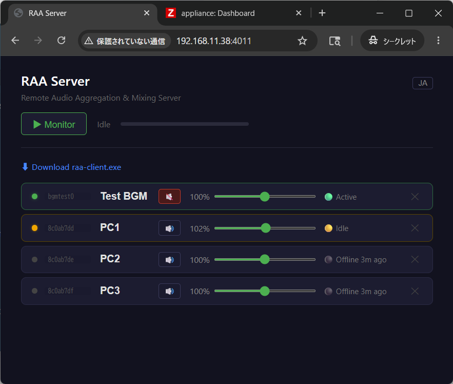
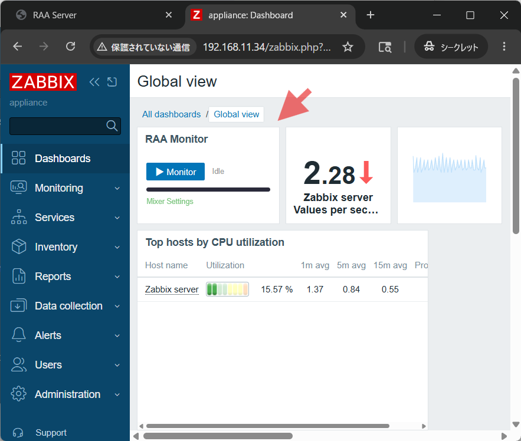

# Remote Audio Aggregation (RAA)

[日本語版はこちら](README.ja.md)

A low-latency audio aggregation system that captures system audio from multiple Windows PCs and streams the mixed audio to browsers. Low resource usage on both client and server, NAT-friendly, no HTTPS required.

<table>
  <tr>
    <td align="center"><b>Win32 Client</b><br></td>
    <td align="center"><b>Server WebUI</b><br></td>
    <td align="center"><b>Zabbix Module</b><br></td>
  </tr>
</table>

## Architecture

```
[Windows PC-A] ──UDP:4010──┐
[Windows PC-B] ──UDP:4010──┤──→ [Linux Server] ──WebSocket:4011── [Zabbix]
[Windows PC-C] ──UDP:4010──┘          │
                                   WebUI :4011
```

- **Clients → Server**: RTP (Opus) over UDP. Destination port: UDP 4010.
- **Browser → Server**: HTTP + WebSocket. Destination port: TCP 4011.
- **Zabbix → Server**: WebSocket. Destination port: TCP 4011.
- **Audio format**: Opus 48 kHz mono, 20 ms frames, 64 kbps, DTX enabled

## Components

| Component | Description |
|-----------|-------------|
| [Win32 Client](client/) | System tray app, WASAPI process loopback capture, RTP/UDP sender |
| [Node.js Server](server/) | UDP receiver, mixer worker thread, WebSocket audio stream, REST management API |
| [Zabbix Module](module/) | Zabbix dashboard widget with WebSocket audio player and Mixer Settings link |

## Download

The latest pre-built release is available on [GitHub Releases](https://github.com/daig0rian/remote-audio-aggregation/releases).

| Asset | Description |
|-------|-------------|
| `raa-client.exe` | Win32 client — download and run, no installer needed |
| `raa-server-x.y.z.tgz` | Server Node.js package |
| `install.sh` | Server install script |
| `raa_monitor-x.y.z.zip` | Zabbix dashboard widget module |

## How It Works

### Audio Pipeline (20 ms cycle)

1. **Win32 client** captures system audio via WASAPI Process Loopback (master-volume-independent), encodes with libopus, and sends RTP packets over UDP.
2. **Server UDP receiver** parses RTP headers, extracts SSRC, RTP timestamp, and marker bit, detects stream gaps (marker bit or >300 ms silence), and forwards the raw Opus payload to the mixer worker thread.
3. **Mixer worker thread** decodes each incoming Opus frame to PCM and enqueues it into the per-client RTP-timestamp-indexed jitter buffer. A precise 20 ms timer then pulls one frame per client (with PLC for missing frames), applies per-client volume scaling, mixes the PCM streams, re-encodes as Opus, and sends the result to the main thread.
4. **Main thread** sends the encoded frame to each connected WebSocket listener.
5. **Browser** decodes Opus via WebAssembly and schedules playback through the Web Audio API.

## Performance

### Verified Measurements

**Test environment**: 1 vCPU (Intel i5-6500T 2.50 GHz), 2 GB RAM, Ubuntu 24.04 LTS (KVM VM)

**Scenario: 40 connected clients, 10 simultaneously speaking, 150 s run**

| Metric | Value |
|--------|-------|
| Mixer cycle time — mean | 0.87 ms |
| Mixer cycle time — p99 | ~2.0 ms |
| Mixer cycle time — max | ~4.4 ms |
| Server CPU usage | ~20 % |

The mixer has a hard 20 ms budget per cycle. At 10 active speakers it uses under 5 % of that budget on a single vCPU.

### Expected Limits

| Active speakers | Mix budget used | Notes |
|----------------|----------------|-------|
| 10 | ~5 % | ✅ Verified on 1 vCPU / 2 GB |
| 25 | ~12 % | Comfortable headroom |
| 40 | ~70 % | Decode ~12 ms; approaching limit |
| 50+ | > 100 % | Frame drops expected |

WebSocket listener count has negligible impact up to ~200 concurrent browsers (each WS send adds ~10 bytes of frame header; the ~150 byte Opus payload is shared).

### Monitoring

The server emits timing statistics every 5 seconds at `info` level:

```json
{"msg":"mix cycle stats","mean_ms":"0.87","p99_ms":"2.0","max_ms":"4.42","avg_active":"11.0"}
{"msg":"event loop delay","mean_ms":"10.6","p99_ms":"12.5","max_ms":"16.8"}
```

`avg_active` is the mean number of clients actually mixed per cycle. `event loop delay` reflects main-thread responsiveness (UDP receive, WebSocket send, HTTP) — elevated here due to load test running on the same VM.

To reproduce the load test:

```bash
# 40 clients registered, 10 sending audio, targeting localhost
node bench/load-test.js 40 10 127.0.0.1
```

## Tech Stack

### Server
- **Runtime**: Node.js ≥ 24 (LTS)
- **HTTP/REST**: [Fastify](https://fastify.dev/)
- **WebSocket**: [ws](https://github.com/websockets/ws)
- **Opus codec**: [@evan/opus](https://github.com/evan/opus) (N-API native binding)
- **Logging**: [pino](https://getpino.io/) (structured JSON, `LOG_LEVEL` env var)
- **Threading**: Worker Threads (mixer runs independently of HTTP/WS event loop)

### Win32 Client
- **Language**: C++ / Win32 API (MSVC)
- **Audio capture**: WASAPI `AUDCLNT_STREAMFLAGS_PROCESS_LOOPBACK` — captures the process audio mix independently of master volume
- **Codec**: libopus 1.3.1 (statically linked, no external DLLs)
- **Network**: Winsock2 UDP, standard RTP framing (RFC 3550 + RFC 7587)
- **UI**: `Shell_NotifyIcon` system tray with three icon states (active / silent / error)
- **Config**: `%APPDATA%\raa-client\raa-client.ini`

## Directory Structure

```
remote-audio-aggregation/
├── client/                  # Win32 C++ client
│   ├── src/
│   │   └── raa-client.cpp   # Main source (WASAPI + libopus + RTP + tray UI)
│   ├── deps/                # libopus static library and headers
│   ├── icons/               # active.ico / silent.ico / error.ico
│   ├── build.bat            # MSVC build script
│   ├── get_opus.bat         # Downloads and builds libopus from source
│   ├── app.manifest         # Windows 10+ compatibility manifest
│   └── raa-client.rc        # Resource file (icons, version info)
├── module/                  # Zabbix dashboard widget
│   ├── manifest.json
│   ├── Widget.php
│   ├── actions/WidgetView.php
│   ├── includes/WidgetForm.php
│   ├── views/
│   │   ├── widget.edit.php
│   │   └── widget.view.php
│   └── assets/
│       ├── css/widget.css
│       └── js/
│           ├── class.widget.js
│           ├── raa-player.js
│           └── opus-decoder.bundle.js
└── server/                  # Node.js server
    ├── src/
    │   ├── main.js          # Entry point: UDP + HTTP + WS wiring
    │   ├── udp.js           # RTP packet receiver and parser
    │   ├── clients.js       # Client registry, Opus decode, config persistence
    │   ├── mixer.js         # Worker thread: jitter buffer, PLC, mix, encode
    │   ├── ogg-reader.js    # Minimal Ogg page parser (used by BGM client)
    │   └── logger.js        # pino instance shared across modules
    ├── assets/
    │   └── goldberg-var1.opus  # Built-in test audio (public domain, ~1 MB)
    ├── public/
    │   └── index.html       # Management WebUI + browser audio player
    ├── package.json
    ├── deploy.bat           # SCP deploy + remote restart helper
    └── raa-server.service   # systemd unit file
```

## Server Setup (Ubuntu 24.04 LTS)

### 1. Install Node.js via nvm

```bash
curl -o- https://raw.githubusercontent.com/nvm-sh/nvm/v0.39.0/install.sh | bash
source ~/.bashrc
nvm install 24
nvm alias default 24
```

### 2. Install raa-server

```bash
curl -fsSL https://github.com/daig0rian/remote-audio-aggregation/releases/latest/download/install.sh | bash
```

The script:
- Checks for Node.js ≥ 24 (exits with an error if not found)
- Downloads and extracts the server package to `~/raa-server`
  - The release tarball bundles `node_modules` (including prebuilt `@evan/opus` binaries), so no `npm install`, no access to registry.npmjs.org, and no build tools (`build-essential` / `libopus-dev`) are needed
- Registers and starts a **systemd user service**
- Runs `loginctl enable-linger` so the service starts at boot without login (requires sudo, once)

### Service management

```bash
systemctl --user status raa-server
systemctl --user restart raa-server
systemctl --user stop raa-server
journalctl --user -u raa-server -f
journalctl --user -u raa-server --since "1 hour ago"
```

### Run in foreground (development)

```bash
cd ~/raa-server
node src/main.js
# with debug logging:
LOG_LEVEL=debug node src/main.js
```

Default ports: UDP `4010` (audio input), HTTP/WS `4011` (web interface).  
Override with environment variables: `UDP_PORT=5004 HTTP_PORT=8080 node src/main.js`

## Win32 Client

### Download (recommended)

Download `raa-client.exe` from [GitHub Releases](https://github.com/daig0rian/remote-audio-aggregation/releases), save it to any folder, and run it directly. No installer needed.

### Build from Source

Requires Visual Studio Build Tools 2022+ with the "Desktop development with C++" workload and Windows SDK.

```bat
cd client
build.bat
```

`build.bat` will automatically fetch and build libopus from source if `deps\libopus.lib` is not present. The output is `client\raa-client.exe`.

### First Launch

On first run with no config file present, the settings dialog opens automatically. Enter the server IP address and click OK. The app then starts capturing and transmitting audio.

The SSRC (client identifier shown in the management WebUI) is generated once and saved to `%APPDATA%\raa-client\raa-client.ini`.

## Zabbix Module

The `raa_monitor` Zabbix widget lets you monitor and listen to the RAA audio stream directly from a Zabbix dashboard.

### Install

1. Download `raa_monitor-x.y.z.zip` from [GitHub Releases](https://github.com/daig0rian/remote-audio-aggregation/releases) and unzip it into the Zabbix modules directory:

   ```bash
   unzip raa_monitor-x.y.z.zip -d /usr/share/zabbix/modules/
   ```

2. In Zabbix: **Administration → General → Modules → Scan directory**, then **Enable** the *RAA Monitor* module.

3. Add the **RAA Monitor** widget to any dashboard and configure:

   | Field | Default | Description |
   |-------|---------|-------------|
   | RAA Server Host | `10.0.0.1` | IP or hostname of the RAA server (as seen from the browser) |
   | WebSocket Port | `4011` | HTTP/WS port of the RAA server |
   | Buffer (ms) | `200` | Jitter buffer size |

## Management WebUI

Open `http://<server>:4011/` in a browser.

- Lists all active and known clients with friendly name, SSRC, and status
- Per-client volume slider (0–200%), mute toggle, and name editor
- Audio player for the mixed stream (click the play button)
- Language toggle (EN/JA) in the top-right corner; browser language is auto-detected on load

## Built-in Test Stream

The server ships a virtual BGM client (`bgmtest0`) that loops a public-domain music clip from the moment the server starts. It appears in the WebUI as **"Test BGM (Goldberg Var.1)"** and allows you to verify end-to-end audio delivery — browser → WebSocket → decoder → playback — without needing any Win32 client connected.

Audio: Bach *Goldberg Variations BWV 988 – Variation 1*, performed by Shelley Katz.  
Source: [musopen.org](https://musopen.org/) · License: [Public Domain](https://creativecommons.org/publicdomain/mark/1.0/).

## RTP Packet Format

Standard RTP (RFC 3550) with Opus payload type 111 (RFC 7587). Compatible with Wireshark, VLC, and FFmpeg for diagnostics.

```
Byte 0:    0x80  (V=2, P=0, X=0, CC=0)
Byte 1:    M | 111  (Marker bit + PT=111)
Bytes 2-3: Sequence number (big-endian)
Bytes 4-7: Timestamp (48 kHz ticks, big-endian)
Bytes 8-11: SSRC (big-endian, client identifier)
Bytes 12+: Opus payload (20 ms, 48 kHz, mono)
```

## Log Levels

| Level | What is logged |
|-------|---------------|
| `info` (default) | Server start/stop, client connect/disconnect |
| `debug` | Decoder resets, per-frame events |
| `warn` | Jitter buffer starvation, resync events |

Set via `LOG_LEVEL=debug` environment variable or in the systemd unit file.
